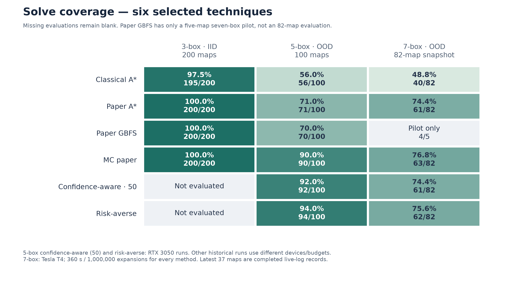
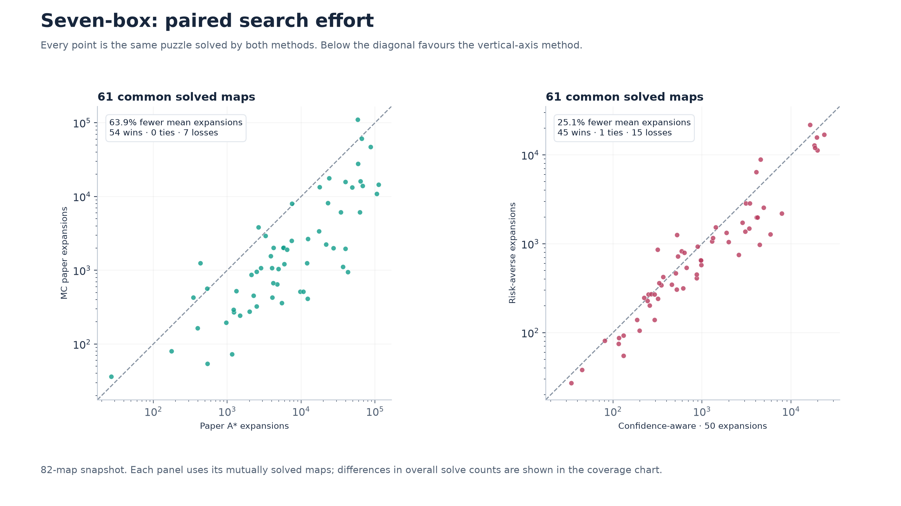
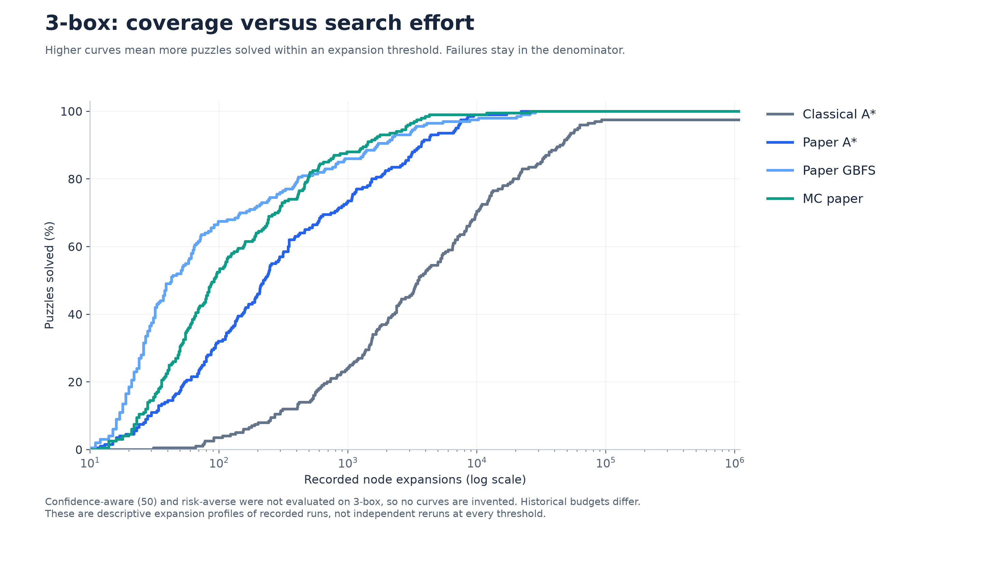
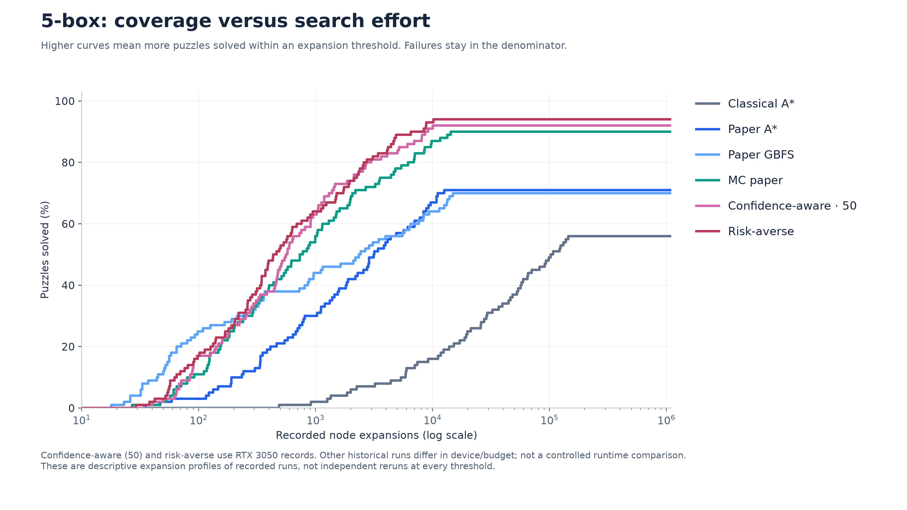
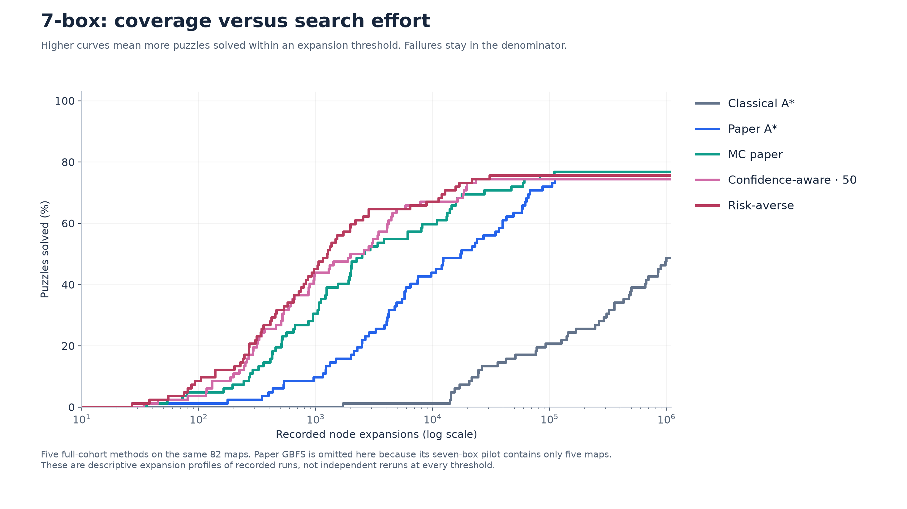
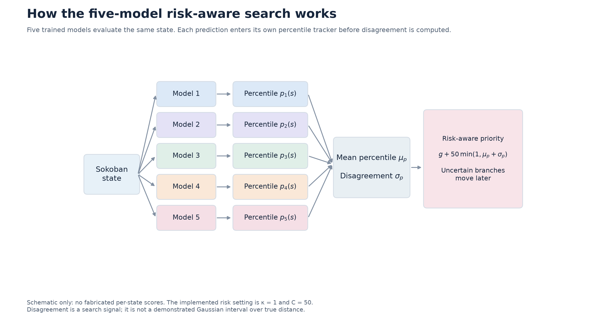
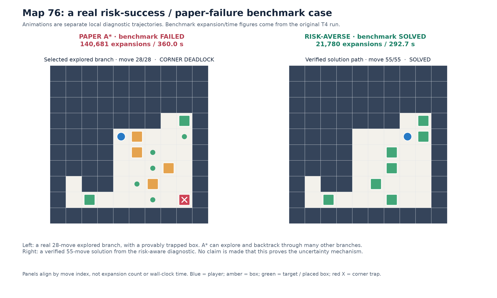

# Clean Sokoban visuals — six methods and a genuine failure case

## What changed

The 3/5/7-box expansion charts now use only Classical, Paper A*, Paper GBFS, MC paper, Confidence-aware (50), and Risk-averse. Unsupported combinations are omitted; seven-box GBFS has only a five-map pilot and is not mixed into the 82-map expansion profile. For five-box confidence (50), the RTX 3050 repetition is selected to match the risk-aware hardware. Historical comparisons across other groups still have different budgets and devices.

## Map 76: what the case study establishes

The original seven-box T4 benchmark records **risk-aware solved at 21,780 expansions / 292.734 seconds**, while **Paper A* failed at the 360-second limit after 140,681 expansions**. These are genuine completed benchmark records. The original cloud action plan had not been exported when these visuals were requested, so both animations use a **separate local XPU diagnostic** with the same original checkpoints and algorithms.

The paper animation follows a real 28-move path to a popped search node. It first pushes a box into an off-target static corner at move 17; that branch is provably unsolvable. A search node is a full puzzle state scored by the network, not a neuron. The selected branch is not the complete A* exploration order. A* explores many branches, and pausing the left animation does not mean its whole search stopped after 28 moves.

The risk animation is an independently replayed solution from the local risk-aware diagnostic. Its local expansion count and timing may differ from the original T4 benchmark; both are retained in `map76_diagnostics.json`. The benchmark numbers displayed on the GIFs are clearly labelled as benchmark numbers. Animation panels align by move index, not elapsed time or expansion number. This illustrates a useful case; it does not prove that uncertainty detected this particular deadlock or that risk-aware never explores dead ends.

## Suggested slide caption

> On this seven-box instance, risk-aware search solved within the common benchmark budget while the learned baseline timed out. The left animation illustrates one genuine baseline branch ending in an irreversible box trap; the right animation shows a verified risk-aware solution. Replay trajectories were captured in a separate diagnostic run.

## Files

- `10_map76_paper_deadend.gif`: one verified baseline branch ending in a corner trap.
- `11_map76_risk_solution.gif`: verified risk-aware solution.
- `12_map76_side_by_side.gif`: presentation-ready paired replay.
- PNG and SVG exports of all six-method plots and the case-study poster.
- Recorded benchmark rows, diagnostic metadata, checkpoint checksums, and legal-replay validation.

Seven-box aggregate plots retain the 82-map snapshot. No repository or existing cloud job was modified by this work.

## Solve coverage

The requested six techniques only. The 5-box confidence-aware (50) curve uses the RTX 3050 repetition.

## Paired search effort

MC paper versus paper A*, and risk-averse versus confidence-aware (50).

## 3-box expansion profiles

Confidence-aware (50) and risk-averse were not evaluated on 3-box, so no curves are invented. Historical budgets differ.

## 5-box expansion profiles

Confidence-aware (50) and risk-averse use RTX 3050 records. Other historical runs differ in device/budget; not a controlled runtime comparison.

## 7-box expansion profiles

Five full-cohort methods on the same 82 maps. Paper GBFS is omitted here because its seven-box pilot contains only five maps.

## Five-model risk-aware pipeline

The mean is an internal component of the retained risk/confidence formulas, not a separately evaluated technique.

## Map 76: risk success and paper failure

Original benchmark counts; separately captured local diagnostic trajectories. The left panel is one explored dead-end branch.

